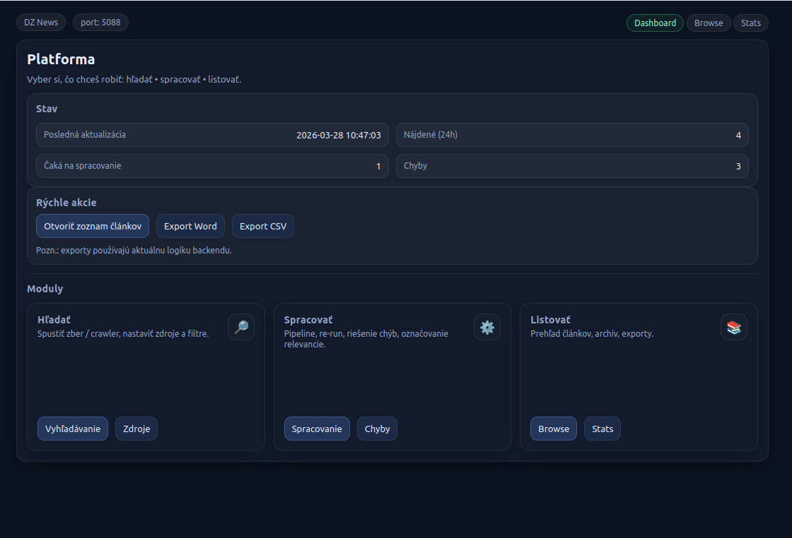

# DZ News Monitor

> **Language / Jazyk / Langue:** [English](#english) · [Slovenčina](#slovenčina) · [Français](#français)


---

## English

### About

**DZ News Monitor** is a Flask web application that tracks Algerian media coverage of Slovakia–Algeria relations. It automatically searches for relevant news articles, extracts their content, and presents them in a review dashboard where articles can be labeled for relevance and exported for analysis.



### Features

- Automated daily news search via **SerpAPI** (Google News)
- Direct scraping of **MFA Algeria** press releases (no SerpAPI required)
- Full-text extraction via **trafilatura** (HTML) and **pymupdf** (PDF)
- Language detection at search time via **langdetect** (title + snippet), refined by trafilatura during extraction
- Arabic → French translation via a **configurable backend** — choose between local [MarianMT](https://huggingface.co/Helsinki-NLP) service, **DeepL API**, **Azure Cognitive Translator**, or an **LLM via build.nvidia.com** via `TRANSLATOR_BACKEND`; `title` + `snippet` translated automatically (pipeline + backfill); `content_text` translated only during fresh extraction or manually via the article detail page
- Relevance labeling and soft-delete workflow
- **AI sports filter** — sports news is detected by an LLM (NVIDIA API, build.nvidia.com) and automatically excluded
- Export to **Word** and **CSV**
- Scheduled pipeline with **email notifications** (new/re-seen articles, translation status)
- **Authentication** — admin/read-only access control (session-based, `users` table in DB)
- Dockerized deployment

### Architecture

```
SerpAPI (Google News)  +  MFA Algeria (mfa.gov.dz)
    ↓  search_flow_news.py       — search, save JSON bundles, detect language (langdetect)
    ↓  search_mfa_gov.py         — scrape MFA press releases (integrated or standalone)
bundle/news_bundle_*.json
    ↓  ingest_to_dz_news_reworked.py  — parse & insert into DB (with language field)
MySQL / MariaDB
    ↓  extract_bulk.py           — fetch URLs, extract text, refine lang_detected, translate AR→FR
    ↓  app.py (Flask)
Web dashboard                    — browse, label, export
```

A `scheduler.py` daemon runs the full pipeline daily and sends a detailed email summary (new articles with titles/snippets, re-seen articles, DeepL credit usage).

### Requirements

- Python 3.12+
- MySQL / MariaDB
- [SerpAPI](https://serpapi.com/) key
- Translation backend (one of, optional):
  - Local MarianMT service (`TRANSLATOR_BACKEND=local`, default)
  - [DeepL API](https://www.deepl.com/pro-api) key (`TRANSLATOR_BACKEND=deepl`)
  - [Azure Cognitive Translator](https://azure.microsoft.com/en-us/products/ai-services/translator) key (`TRANSLATOR_BACKEND=azure`)
  - [NVIDIA build.nvidia.com](https://build.nvidia.com/) key (`TRANSLATOR_BACKEND=nvidia`, same `NVIDIA_API_KEY` as the sports filter)
- `langdetect` (installed via `requirements.txt`)
- Docker (for containerized deployment)

### Installation

```bash
git clone https://github.com/eavf/SK_DZ_media.git
cd SK_DZ_media

python -m venv .venv
source .venv/bin/activate
pip install -r requirements.txt
```

Copy `.env.example` to `.env` and fill in your credentials:

```bash
cp .env.example .env
```

### Configuration

Key `.env` variables:

| Variable | Description |
|---|---|
| `SERPAPI_KEY` | SerpAPI key for Google News search |
| `DB_HOST / DB_PORT / DB_NAME / DB_USER / DB_PASS` | MySQL connection |
| `TRANSLATOR_BACKEND` | Translation backend: `local` (default), `deepl`, `azure`, or `nvidia` |
| `TRANSLATOR_URL` | URL of the local MarianMT service (default: `https://translate.eavf1621.synology.me`) |
| `DEEPL_API_KEY` | DeepL API key (required when `TRANSLATOR_BACKEND=deepl`) |
| `AZURE_TRANSLATOR_KEY` | Azure Cognitive Translator key (required when `TRANSLATOR_BACKEND=azure`) |
| `AZURE_TRANSLATOR_REGION` | Azure region (default: `westeurope`) |
| `FLASK_SECRET_KEY` | Flask session secret |
| `FLASK_PORT` | Web server port (default: `5088`) |
| `SMTP_HOST / SMTP_USER / SMTP_PASS / NOTIFY_TO` | Email notifications (optional) |
| `NVIDIA_API_KEY` | NVIDIA API key for the AI sports filter (optional — filter is disabled without it) |
| `NVIDIA_MODEL` | LLM model (default: `meta/llama-3.2-11b-vision-instruct`) |
| `NVIDIA_TRANSLATE_MODEL` | LLM model for `TRANSLATOR_BACKEND=nvidia` (default: `nvidia/nemotron-3-super-120b-a12b`) |
| `AI_CLASSIFY_ENABLED / AI_CLASSIFY_DELAY` | Turn the AI filter off (`0`) / min. seconds between API calls (default `1.5`) |

Static config files in `config/`:

| File | Purpose |
|---|---|
| `sources.json` | Preferred Algerian news domains |
| `ranking.json` | Per-domain quality scores |
| `topics.json` | Keyword lists (FR / EN / AR) for topic detection |
| `search_terms.json` | SerpAPI query terms |
| `url_cleanup.json` | Query params stripped from URLs before dedup |

### Usage

**Run the data pipeline manually:**

```bash
# Step 1 – search for articles (SerpAPI + MFA Algeria combined)
python search_flow_news.py

# Step 1b – scrape MFA Algeria press releases only (standalone)
python search_mfa_gov.py --when 30d

# Step 2 – ingest into database
python ingest_to_dz_news_reworked.py

# Step 3 – extract full text (+ AI sports filter + translate Arabic)
python extract_bulk.py
```

**Start the web dashboard:**

```bash
python app.py
# → http://localhost:5088
```

**Run the scheduler (daily automation):**

```bash
python scheduler.py
```

### Search query configuration

`search_flow_news.py` accepts four parameters that control each search run:

| Parameter | Default | Description |
|---|---|---|
| `--hl` | `fr` | Result language passed to SerpAPI (e.g. `fr`, `ar`, `en`) |
| `--gl` | `dz` | Search country passed to SerpAPI (e.g. `dz`, `fr`) |
| `--num` | `20` | Maximum results per query |
| `--when` | `7d` | Time window: `1d`, `7d`, `30d`, `2h`, etc. |

**Manual run from the web UI** (`/search`): all four parameters are editable in the form before each run. Leaving a field empty uses the default.

**Scheduled run** (`scheduler.py`): always uses the default values above — the scheduler passes no arguments to the script.

#### Query strategy (Q1 / Q2 / Q3)

Each run executes up to three SerpAPI queries:

| Query | Scope | Trigger |
|---|---|---|
| Q1 | Preferred domains only (`site:domain1 OR site:domain2 …`) + Slovakia terms | Always |
| Q2 | Broad Algerian web (`site:.dz`) + Slovakia terms | Always |
| Q3 | Global fallback — Slovakia terms + Algeria terms, no `site:` restriction | Only if Q1+Q2 return too few results or no preferred-domain articles |

**How query strings are assembled:**

- **Q1:** `(site:aps.dz OR site:elmoudjahid.com OR …) (Slovaquie OR Slovak OR …) -inurl:recherche -inurl:search -inurl:tag -inurl:tags -inurl:page`
- **Q2:** `site:.dz (Slovaquie OR Slovak OR …) -inurl:recherche -inurl:search -inurl:tag -inurl:tags -inurl:page`
- **Q3:** `(Slovaquie OR Slovak OR …) (Algérie OR Algeria OR …)`

Multi-word Algeria terms are automatically quoted (e.g. `"El Mouradia"`). URL filters are omitted from Q3 to maximise recall.

**Effect of the `gl` parameter on each query:**

- **Q1** — minimal impact. Results are already fixed to specific domains by the `site:` list.
- **Q2** — partial. `site:.dz` already restricts to Algerian domains; `gl=dz` may affect ranking within those results.
- **Q3** — most significant. With no `site:` restriction, `gl=dz` acts as a soft geographic filter: Google returns results as seen from Algeria, naturally prioritising Algerian and Francophone sources. Changing to `gl=fr` shifts the mix toward French sources; `gl=sk` would surface Slovak websites — neither is the intended behaviour.

#### Query length limits

Google enforces a hard limit of approximately **2 048 characters** per query string. At around **1 500 characters** the script emits a warning in the log; at or above 2 048 it logs an error indicating that results may be incomplete or the query may be silently truncated.

The risk is highest for **Q1**: each preferred domain adds roughly 20–25 characters to the `site:` OR chain. With a large `sources.json` list, Q1 can approach the limit. Q2 and Q3 are unaffected in practice.

If the warning appears, options are:
- Remove lower-priority domains from `config/sources.json`
- Save a shorter hand-crafted query as a Q1 preset via **Admin → Queries**

#### Configuring queries and search terms

- **Search terms** (Slovakia / Algeria keyword lists) — edit via **Admin → Search Terms** (`/admin/search-terms`) or directly in `config/search_terms.json`. Changes take effect immediately without restart.
- **Query presets** — save custom query strings and switch between them via **Admin → Queries** (`/admin/queries`). The active preset overrides the auto-generated query for Q1, Q2, or Q3 independently. Setting a preset back to `default` restores dynamic generation from the current search terms.

### Authentication

The app uses session-based authentication with four access levels:

| Role | Access |
|---|---|
| Unauthenticated | Browse articles, view article detail, stats |
| `user` | + Run pipeline: search, ingest, extract, translate |
| `power` | + Label, delete, export, modify article records |
| `admin` | + Sources management, user management |

Roles are hierarchical — each level includes everything below it.

**Initial setup** (run once on a new server):

```bash
python setup_db.py
```

This script creates the database, all tables, and prompts you to create the first admin account interactively.

To add more users afterwards:

```bash
python create_admin.py                 # admin (default)
python create_admin.py --role power    # power user
python create_admin.py --role user     # regular user
```

> **Existing installations:** `migrations/000_init_schema.sql` and the individual migration files (`001_add_users.sql`, `002_user_roles.sql`) remain available for manual use or upgrading older deployments.

### Article date resolution

Each article stores three date-related fields:

| DB field | Description |
|---|---|
| `published_at_text` | Raw date string as returned by SerpAPI (e.g. `"Il y a 5 jours"`, `"2025-12-09"`) |
| `published_at_real` | Parsed datetime used for sorting and display |
| `published_conf` | Confidence label: `search` (from SerpAPI) or `absolute` (from HTML extraction) |

**Processing pipeline:**

```
SerpAPI date field
    ↓ search_flow_news._parse_serp_date()
    │
    ├─ absolute date (e.g. "2025-12-09")
    │       → stored as published_at in bundle JSON
    │       → ingest sets published_at_real, published_conf = 'search'
    │
    └─ relative date (e.g. "yesterday", "il y a 3 jours")
            → NOT stored in bundle — too unreliable for re-surfaced articles
            → published_at_real stays NULL until extraction

HTML extraction (trafilatura via extract_bulk.py / refetch_article.py)
    → reads <meta property="article:published_time"> and similar tags
    → overwrites published_at_real, sets published_conf = 'absolute'
```

**Why relative SerpAPI dates are not used:** Google News can re-surface old articles in new searches. A date like `"yesterday"` is then computed relative to the search time, not the article's true publication date — resulting in values that are months off. Only absolute date strings from SerpAPI are trusted at ingest time; all others are resolved later from the article HTML.

**Maintenance:** `fix_serp_dates.py` can be used to reset any `published_at_real` values that were ingested from relative SerpAPI dates (detects them by matching the raw `published_at_text` against relative-date patterns).

### PDF extraction

When a search result links directly to a PDF (detected by `Content-Type: application/pdf` or a `.pdf` URL), the extractor uses **pymupdf** instead of trafilatura.

**Page-level SK filtering:** Only pages containing at least one configured Slovakia search term are extracted and stored. This keeps `content_text` focused on relevant content instead of storing the full newspaper issue.

**Legacy Arabic encoding detection:** Many Algerian Arabic-language newspapers distribute PDF editions using old proprietary font encodings (AXT and similar). The extracted text appears as garbled Latin characters (`÷õGFô`, `ZƒGJ«ªÉ'`). The extractor detects this automatically and sets `fetch_error = PDF_LEGACY_ENCODING` without storing the garbled content.

| `fetch_error` value | Meaning |
|---|---|
| `PDF_EXTRACTION_EMPTY` | pymupdf returned no text (e.g. image-only PDF) |
| `PDF_LEGACY_ENCODING` | Garbled legacy Arabic font encoding — content not stored |

### MFA Algeria scraper

`search_mfa_gov.py` scrapes press releases directly from the Algerian Ministry of Foreign Affairs website (`mfa.gov.dz`) without using SerpAPI.

**How it works:** The MFA site is built with Next.js. The scraper fetches the `buildId` from the page source and then paginates through the `/_next/data/{buildId}/...` JSON endpoint, filtering results by the configured Slovakia search terms.

**Integration:** `search_flow_news.py` calls the scraper automatically and merges its results into the standard bundle alongside SerpAPI results. The domain `mfa.gov.dz` is excluded from SerpAPI queries to avoid duplicates.

**Standalone use:**

```bash
python search_mfa_gov.py --when 30d   # last 30 days (default)
python search_mfa_gov.py --when 7d    # last 7 days
```

Results are saved to a dedicated `mfa_<timestamp>` run directory inside `bundle/runs/` in the same format as `search_flow_news.py`, and can be ingested with the standard `ingest_to_dz_news_reworked.py`.

**SSL note:** `mfa.gov.dz` uses an unverifiable SSL certificate. The scraper bypasses verification (`verify=False`) and suppresses the resulting warnings — this is expected and intentional.

### AI sports filter

After a successful extraction, `extract_bulk.py` (and `refetch_article.py`) sends the title and the first 2000 characters of the article to an LLM via the **NVIDIA API** (build.nvidia.com, OpenAI-compatible) and asks whether the article is sports news. The check runs after the cheap keyword filters and **before translation**, so no translation credits are spent on sports articles.

- **Sport** = match reports, results, rankings, qualifications, competitions, athletes, transfers.
- **Not sport** = politics, diplomacy, economy, statements of ministers about sports policy or hosting events, sports diplomacy, articles mentioning sport only in passing.

**What happens to a sports article:** soft delete (`deleted_at`), `relevance = 0`, `relevance_note = "auto: sport (AI) – <reason>"`, `ai_label = 'sport'`. The row is **not** hard-deleted — the `url_hash` dedup keeps it from being re-ingested and re-classified when the same URL shows up in a later search.

**Safety rules:**
- each article is classified only once (`ai_checked_at`); articles with a manually set `relevance` are never touched;
- if the API fails, the article stays unclassified and is retried on the next run — an API outage never excludes anything;
- on rate limit (HTTP 429) or after 3 consecutive failures (30 s timeout per call) the AI check stops for the current run, so the pipeline never waits on an unavailable API;
- without `NVIDIA_API_KEY` the filter is disabled and the pipeline behaves as before.

**Review in the dashboard:** `/browse` → button **"Vyradené AI"** (or filter *Deleted* → *len vyradené AI*) lists the excluded articles with a purple **šport (AI)** badge; the reason is in the tooltip. A false positive is restored with the standard undelete.

**Backfill existing articles:**

```bash
python classify_existing.py --limit 20            # dry-run: calls the AI, prints results, writes nothing
python classify_existing.py --apply --limit 500   # writes results
```

The free tier allows ~40 requests/minute; `AI_CLASSIFY_DELAY=1.5` keeps the backfill within that limit. Requires migration `migrations/003_ai_classification.sql` (columns `ai_label`, `ai_checked_at`).

### Database backup and restore

The admin maintenance page (`/admin/maintenance`) provides a browser-based backup and restore interface. It requires `mysqldump` and `mysql` to be available on the server.

**Backup** — downloads a full `mysqldump` of the database as a `.sql` file (filename includes timestamp).

**Restore** — uploads a `.sql` dump file. Before importing, the application automatically runs `migrations/000_init_schema.sql` (uses `CREATE TABLE IF NOT EXISTS`) to ensure all tables exist. This means restore works on a completely empty database as well.

> **Note:** restore is destructive — existing rows may be overwritten. A confirmation dialog is shown before proceeding.

### Docker

```bash
docker compose up --build
```

The image is also available on Docker Hub:

```bash
docker pull eavfeavf/dz-news:latest
```

---

## Slovenčina

### O projekte

**DZ News Monitor** je Flask webová aplikácia na sledovanie alžírskych mediálnych správ o vzťahoch Slovensko–Alžírsko. Automaticky vyhľadáva relevantné články, extrahuje ich obsah a zobrazuje ich v prehľadovom dashboarde, kde ich možno označiť podľa relevancie a exportovať na analýzu.


### Funkcie

- Automatické denné vyhľadávanie cez **SerpAPI** (Google News)
- Priame prehľadávanie press releases **MFA Alžírsko** (bez SerpAPI)
- Extrakcia plného textu cez **trafilatura** (HTML) a **pymupdf** (PDF)
- Detekcia jazyka pri vyhľadávaní cez **langdetect** (title + snippet), upresnená trafilaturou pri extrakcii
- Preklad arabčiny do francúzštiny cez **konfigurovateľný backend** — výber medzi lokálnou službou [MarianMT](https://huggingface.co/Helsinki-NLP), **DeepL API**, **Azure Cognitive Translator** alebo **LLM cez build.nvidia.com** cez `TRANSLATOR_BACKEND`; `title` + `snippet` sa prekladajú automaticky (pipeline + backfill); `content_text` iba pri čerstvej extrakcii alebo manuálne cez stránku článku
- Označovanie relevancie a soft-delete workflow
- **AI filter športu** — športové spravodajstvo rozpozná LLM (NVIDIA API, build.nvidia.com) a automaticky ho vyradí
- Export do **Word** a **CSV**
- Automatická pipeline s **emailovými notifikáciami** (nové/znovu videné články, stav prekladu)
- **Autentifikácia** — prístupové práva admin / len čítanie (session-based, tabuľka `users` v DB)
- Dockerizované nasadenie

### Architektúra

```
SerpAPI (Google News)  +  MFA Alžírsko (mfa.gov.dz)
    ↓  search_flow_news.py       — vyhľadávanie, uloženie JSON súborov, detekcia jazyka (langdetect)
    ↓  search_mfa_gov.py         — scraping MFA press releases (integrovaný alebo samostatný)
bundle/news_bundle_*.json
    ↓  ingest_to_dz_news_reworked.py  — spracovanie a vloženie do DB (vrátane poľa language)
MySQL / MariaDB
    ↓  extract_bulk.py           — stiahnutie URL, extrakcia textu, upresnenie lang_detected, preklad AR→FR
    ↓  app.py (Flask)
Webový dashboard                 — prehľad, označovanie, export
```

`scheduler.py` spúšťa celú pipeline denne a posiela podrobný emailový súhrn (nové/znovu videné články s titulmi a snippetmi, stav prekladu, využitie DeepL kreditov).

### Požiadavky

- Python 3.12+
- MySQL / MariaDB
- Kľúč [SerpAPI](https://serpapi.com/)
- Prekladový backend (jeden z, voliteľné):
  - Lokálna MarianMT služba (`TRANSLATOR_BACKEND=local`, default)
  - Kľúč [DeepL API](https://www.deepl.com/pro-api) (`TRANSLATOR_BACKEND=deepl`)
  - Kľúč [Azure Cognitive Translator](https://azure.microsoft.com/en-us/products/ai-services/translator) (`TRANSLATOR_BACKEND=azure`)
  - Kľúč [NVIDIA build.nvidia.com](https://build.nvidia.com/) (`TRANSLATOR_BACKEND=nvidia`, rovnaký `NVIDIA_API_KEY` ako filter športu)
- `langdetect` (inštaluje sa cez `requirements.txt`)
- Docker (pre kontajnerizované nasadenie)

### Inštalácia

```bash
git clone https://github.com/eavf/SK_DZ_media.git
cd SK_DZ_media

python -m venv .venv
source .venv/bin/activate
pip install -r requirements.txt
```

Skopíruj `.env.example` do `.env` a vyplň prístupové údaje:

```bash
cp .env.example .env
```

### Konfigurácia

Kľúčové premenné v `.env`:

| Premenná | Popis |
|---|---|
| `SERPAPI_KEY` | Kľúč SerpAPI pre Google News |
| `DB_HOST / DB_PORT / DB_NAME / DB_USER / DB_PASS` | MySQL pripojenie |
| `TRANSLATOR_BACKEND` | Prekladový backend: `local` (default), `deepl`, `azure` alebo `nvidia` |
| `TRANSLATOR_URL` | URL lokálnej MarianMT služby (default: `https://translate.eavf1621.synology.me`) |
| `DEEPL_API_KEY` | Kľúč DeepL (vyžadované pri `TRANSLATOR_BACKEND=deepl`) |
| `AZURE_TRANSLATOR_KEY` | Kľúč Azure Cognitive Translator (vyžadované pri `TRANSLATOR_BACKEND=azure`) |
| `AZURE_TRANSLATOR_REGION` | Azure región (default: `westeurope`) |
| `FLASK_SECRET_KEY` | Secret pre Flask session |
| `FLASK_PORT` | Port webservera (default: `5088`) |
| `SMTP_HOST / SMTP_USER / SMTP_PASS / NOTIFY_TO` | Emailové notifikácie (voliteľné) |
| `NVIDIA_API_KEY` | NVIDIA API kľúč pre AI filter športu (voliteľné — bez neho je filter vypnutý) |
| `NVIDIA_MODEL` | LLM model (default: `meta/llama-3.2-11b-vision-instruct`) |
| `NVIDIA_TRANSLATE_MODEL` | LLM model pre `TRANSLATOR_BACKEND=nvidia` (default: `nvidia/nemotron-3-super-120b-a12b`) |
| `AI_CLASSIFY_ENABLED / AI_CLASSIFY_DELAY` | Vypnutie AI filtra (`0`) / min. sekúnd medzi volaniami API (default `1.5`) |

### Použitie

**Manuálne spustenie pipeline:**

```bash
# Krok 1 – vyhľadanie článkov (SerpAPI + MFA Alžírsko spolu)
python search_flow_news.py

# Krok 1b – len MFA Alžírsko press releases (samostatný režim)
python search_mfa_gov.py --when 30d

# Krok 2 – ingest do databázy
python ingest_to_dz_news_reworked.py

# Krok 3 – extrakcia textu (+ AI filter športu + preklad arabčiny)
python extract_bulk.py
```

**Spustenie webového dashboardu:**

```bash
python app.py
# → http://localhost:5088
```

**Spustenie schedulera (denná automatizácia):**

```bash
python scheduler.py
```

### Konfigurácia vyhľadávacích dopytov

`search_flow_news.py` prijíma štyri parametre, ktoré riadia každé vyhľadávanie:

| Parameter | Default | Popis |
|---|---|---|
| `--hl` | `fr` | Jazyk výsledkov pre SerpAPI (napr. `fr`, `ar`, `en`) |
| `--gl` | `dz` | Krajina vyhľadávania pre SerpAPI (napr. `dz`, `fr`) |
| `--num` | `20` | Maximálny počet výsledkov na dopyt |
| `--when` | `7d` | Časové okno: `1d`, `7d`, `30d`, `2h` atď. |

**Manuálne spustenie cez web UI** (`/search`): všetky štyri parametre sú editovateľné vo formulári pred každým spustením. Prázdne pole použije default.

**Automatické spustenie** (`scheduler.py`): vždy používa vyššie uvedené defaulty — scheduler neodovzdáva skriptu žiadne argumenty.

#### Stratégia dopytov (Q1 / Q2 / Q3)

Každý beh vykonáva až tri SerpAPI dopyty:

| Dopyt | Rozsah | Spustenie |
|---|---|---|
| Q1 | Len preferované domény (`site:domena1 OR site:domena2 …`) + slovenské termíny | Vždy |
| Q2 | Široký alžírsky web (`site:.dz`) + slovenské termíny | Vždy |
| Q3 | Globálny fallback — slovenské termíny + alžírske termíny, bez obmedzenia `site:` | Len ak Q1+Q2 vrátia málo výsledkov alebo žiadne z preferovaných domén |

**Skladba query reťazcov:**

- **Q1:** `(site:aps.dz OR site:elmoudjahid.com OR …) (Slovaquie OR Slovak OR …) -inurl:recherche -inurl:search -inurl:tag -inurl:tags -inurl:page`
- **Q2:** `site:.dz (Slovaquie OR Slovak OR …) -inurl:recherche -inurl:search -inurl:tag -inurl:tags -inurl:page`
- **Q3:** `(Slovaquie OR Slovak OR …) (Algérie OR Algeria OR …)`

Viacslovné alžírske termíny sa automaticky dávajú do úvodzoviek (napr. `"El Mouradia"`). URL filtre sa v Q3 vynechávajú, aby sa maximalizoval záber.

**Vplyv parametra `gl` na jednotlivé dopyty:**

- **Q1** — minimálny. Výsledky sú fixované na konkrétne domény cez `site:` zoznam.
- **Q2** — čiastočný. `site:.dz` už obmedzuje na alžírske domény; `gl=dz` môže ovplyvniť zoradenie výsledkov v ich rámci.
- **Q3** — **najvýraznejší**. Bez `site:` obmedzenia `gl=dz` funguje ako soft geografický filter: Google vracia výsledky akoby používateľ hľadal z Alžírska, čím prirodzene uprednostňuje alžírske a frankofónne zdroje. Zmena na `gl=fr` posunie mix smerom k francúzskym zdrojom; `gl=sk` by vracal slovenské weby — žiadna z týchto alternatív nie je žiaduca.

#### Limity dĺžky query

Google má hard limit približne **2 048 znakov** na jeden query reťazec. Pri **1 500 znakoch** skript vypíše varovanie do logu; pri 2 048 a viac zaloguje chybu s upozornením, že výsledky môžu byť neúplné alebo query môže byť potichu skrátený.

Riziko sa týka hlavne **Q1**: každá preferovaná doména pridá ~20–25 znakov do `site:` OR reťazca. Pri rozsiahlom zozname `sources.json` sa Q1 môže priblížiť k limitu. Q2 a Q3 sú v praxi bezpečné.

Ak sa varovanie objaví, možnosti sú:
- Odstrán menej dôležité domény z `config/sources.json`
- Ulož kratší ručne zostavený query ako Q1 preset cez **Admin → Queries**

#### Nastavenie dopytov a vyhľadávacích termínov

- **Vyhľadávacie termíny** (zoznamy kľúčových slov pre Slovensko / Alžírsko) — upraviť cez **Admin → Search Terms** (`/admin/search-terms`) alebo priamo v `config/search_terms.json`. Zmeny sa prejavia okamžite bez reštartu.
- **Presety dopytov** — uložiť vlastné query reťazce a prepínať medzi nimi cez **Admin → Queries** (`/admin/queries`). Aktívny preset nahradí automaticky generovaný dopyt pre Q1, Q2 alebo Q3 nezávisle. Nastavením presetu späť na `default` sa obnoví dynamické generovanie z aktuálnych termínov.

### Autentifikácia

Aplikácia používa session-based autentifikáciu so štyrmi úrovňami prístupu:

| Rola | Prístup |
|---|---|
| Neprihlásený | Prehliadanie článkov, detail článku, štatistiky |
| `user` | + Spúšťanie pipeline: search, ingest, extrakcia, preklad |
| `power` | + Označovanie, mazanie, export, úprava záznamov článkov |
| `admin` | + Správa zdrojov, správa používateľov |

Roly sú hierarchické — každá úroveň zahŕňa všetko z nižších úrovní.

**Prvotné nastavenie** (spustiť raz na novom serveri):

```bash
python setup_db.py
```

Skript vytvorí databázu, všetky tabuľky a interaktívne vytvorí prvého admin používateľa.

Pre pridanie ďalších používateľov:

```bash
python create_admin.py                 # admin (default)
python create_admin.py --role power    # power user
python create_admin.py --role user     # bežný používateľ
```

> **Existujúce inštalácie:** `migrations/000_init_schema.sql` a jednotlivé migrácie (`001_add_users.sql`, `002_user_roles.sql`) sú naďalej k dispozícii pre manuálne použitie alebo upgrade starších nasadení.

### Určovanie dátumu článku

Každý článok uchováva tri dátumové polia:

| Pole v DB | Popis |
|---|---|
| `published_at_text` | Surový reťazec dátumu z SerpAPI (napr. `"Il y a 5 jours"`, `"2025-12-09"`) |
| `published_at_real` | Sparsovaný datetime používaný na zoradenie a zobrazenie |
| `published_conf` | Dôveryhodnosť: `search` (zo SerpAPI) alebo `absolute` (z HTML extrakcie) |

**Procesný postup:**

```
Pole date zo SerpAPI
    ↓ search_flow_news._parse_serp_date()
    │
    ├─ absolútny dátum (napr. "2025-12-09")
    │       → uložený ako published_at v bundle JSON
    │       → ingest nastaví published_at_real, published_conf = 'search'
    │
    └─ relatívny dátum (napr. "yesterday", "il y a 3 jours")
            → NEULOŽENÝ do bundle — nespoľahlivý pre re-surfované staré články
            → published_at_real ostáva NULL až do extrakcie

HTML extrakcia (trafilatura cez extract_bulk.py / refetch_article.py)
    → číta <meta property="article:published_time"> a podobné tagy
    → prepíše published_at_real, nastaví published_conf = 'absolute'
```

**Prečo sa relatívne dátumy zo SerpAPI nepoužívajú:** Google News môže staré články znovu zaradiť do výsledkov vyhľadávania. Dátum ako `"yesterday"` sa potom vypočíta relatívne od času searchu, nie od skutočného dátumu publikovania — výsledok je o mesiace nesprávny. Pri ingeste sa preto dôveruje iba absolútnym reťazcom; ostatné sa doplnia neskôr z HTML článku.

**Údržba:** `fix_serp_dates.py` resetuje prípadné `published_at_real` hodnoty, ktoré boli nastavené z relatívnych dátumov SerpAPI (detekuje ich podľa vzoru v `published_at_text`).

### Extrakcia PDF

Ak výsledok vyhľadávania odkazuje priamo na PDF (detekcia podľa `Content-Type: application/pdf` alebo prípony `.pdf`), extraktor použije **pymupdf** namiesto trafilatura.

**Filtrovanie stránok podľa SK termínov:** Ukladajú sa len stránky, ktoré obsahujú aspoň jeden nakonfigurovaný slovenský vyhľadávací termín. Vďaka tomu `content_text` obsahuje iba relevantnú časť namiesto celého čísla novín.

**Detekcia starého arabského kódovania:** Mnohé alžírske arabské noviny distribuujú PDF vydania so starými proprietárnymi kódovaniami fontov (AXT a pod.). Extrahovaný text sa zobrazí ako nezmyselné Latin znaky (`÷õGFô`, `ZƒGJ«ªÉ'`). Extraktor to automaticky detekuje a nastaví `fetch_error = PDF_LEGACY_ENCODING` bez uloženia obsahu.

| Hodnota `fetch_error` | Význam |
|---|---|
| `PDF_EXTRACTION_EMPTY` | pymupdf nevrátil žiadny text (napr. PDF tvorené len obrázkami) |
| `PDF_LEGACY_ENCODING` | Staré arabské kódovanie fontov — obsah sa neuloží |

### MFA Alžírsko scraper

`search_mfa_gov.py` prehľadáva press releases priamo z webu Ministerstva zahraničných vecí Alžírska (`mfa.gov.dz`) bez SerpAPI.

**Ako to funguje:** Web MFA je postavený na Next.js. Skript načíta `buildId` zo zdrojového kódu stránky a potom stránkuje cez endpoint `/_next/data/{buildId}/...`, pričom filtruje výsledky podľa nakonfigurovaných slovenských termínov.

**Integrácia:** `search_flow_news.py` volá scraper automaticky a zlúči jeho výsledky do štandardného bundle spolu s výsledkami SerpAPI. Doména `mfa.gov.dz` je vylúčená z SerpAPI dopytov, aby nedochádzalo k duplikátom.

**Samostatné spustenie:**

```bash
python search_mfa_gov.py --when 30d   # posledných 30 dní (default)
python search_mfa_gov.py --when 7d    # posledných 7 dní
```

Výsledky sa uložia do dedikovaného adresára `mfa_<timestamp>` v `bundle/runs/` v rovnakom formáte ako `search_flow_news.py` a možno ich ingestovať štandardným `ingest_to_dz_news_reworked.py`.

**Poznámka k SSL:** `mfa.gov.dz` používa neoveriteľný SSL certifikát. Skript obchádza overenie (`verify=False`) a potláča príslušné varovania — je to zámerné.

### AI filter športu

Po úspešnej extrakcii `extract_bulk.py` (aj `refetch_article.py`) pošle nadpis a prvých 2000 znakov článku do LLM cez **NVIDIA API** (build.nvidia.com, OpenAI-kompatibilné) s otázkou, či ide o športové spravodajstvo. Kontrola beží po lacných filtroch kľúčových slov a **pred prekladom**, takže sa na športové články neminú kredity prekladača.

- **Šport** = reportáže zo zápasov, výsledky, rebríčky, kvalifikácie, súťaže, športovci, prestupy.
- **Nie šport** = politika, diplomacia, ekonomika, vyjadrenia ministrov o športovej politike či hosťovaní podujatí, športová diplomacia, články so športom len okrajovo.

**Čo sa stane so športovým článkom:** soft delete (`deleted_at`), `relevance = 0`, `relevance_note = "auto: sport (AI) – <dôvod>"`, `ai_label = 'sport'`. Riadok sa **nemaže** natvrdo — dedup cez `url_hash` zabráni tomu, aby sa pri ďalšom searchi ingestoval a klasifikoval znova.

**Bezpečnostné pravidlá:**
- každý článok sa klasifikuje len raz (`ai_checked_at`); články s ručne nastavenou `relevance` AI nikdy nemení;
- ak API zlyhá, článok ostane neklasifikovaný a skúsi sa pri ďalšom behu — výpadok API nikdy nič nevyradí;
- pri rate limite (HTTP 429) alebo po 3 zlyhaniach za sebou (timeout 30 s na volanie) sa AI kontrola v danom behu zastaví, pipeline teda nečaká na nedostupné API;
- bez `NVIDIA_API_KEY` je filter vypnutý a pipeline beží ako doteraz.

**Kontrola v dashboarde:** `/browse` → tlačidlo **„Vyradené AI“** (alebo filter *Zmazané* → *len vyradené AI*) zobrazí vyradené články s fialovým štítkom **šport (AI)**; dôvod je v tooltipe. Omyl sa vráti štandardným undelete.

**Spätná klasifikácia existujúcich článkov:**

```bash
python classify_existing.py --limit 20            # dry-run: zavolá AI, vypíše výsledky, nič nezapíše
python classify_existing.py --apply --limit 500   # zapíše výsledky
```

Free tier povoľuje ~40 požiadaviek/minútu; `AI_CLASSIFY_DELAY=1.5` drží spätnú klasifikáciu v limite. Vyžaduje migráciu `migrations/003_ai_classification.sql` (stĺpce `ai_label`, `ai_checked_at`).

### Záloha a obnova databázy

Stránka správy (`/admin/maintenance`) poskytuje zálohu a obnovu priamo z prehliadača. Vyžaduje prítomnosť `mysqldump` a `mysql` na serveri.

**Záloha** — stiahne úplný `mysqldump` databázy ako `.sql` súbor (názov obsahuje časovú pečiatku).

**Obnova** — nahrá `.sql` dump. Pred importom aplikácia automaticky spustí `migrations/000_init_schema.sql` (`CREATE TABLE IF NOT EXISTS`), čím zabezpečí existenciu všetkých tabuliek. Obnova teda funguje aj na úplne prázdnej databáze.

> **Pozor:** obnova je deštruktívna — existujúce záznamy môžu byť prepísané. Pred spustením sa zobrazí potvrdzovací dialóg.

### Docker

```bash
docker compose up --build
```

Image je dostupný aj na Docker Hub:

```bash
docker pull eavfeavf/dz-news:latest
```

---

## Français

### À propos

**DZ News Monitor** est une application web Flask qui surveille la couverture médiatique algérienne des relations Slovaquie–Algérie. Elle recherche automatiquement les articles pertinents, en extrait le contenu et les présente dans un tableau de bord de révision permettant de les étiqueter par pertinence et de les exporter pour analyse.


### Fonctionnalités

- Recherche automatique quotidienne via **SerpAPI** (Google Actualités)
- Collecte directe des communiqués de presse du **MAE Algérie** (sans SerpAPI)
- Extraction du texte intégral via **trafilatura** (HTML) et **pymupdf** (PDF)
- Détection de la langue dès la recherche via **langdetect** (titre + extrait), affinée par trafilatura à l'extraction
- Traduction arabe → français via un **backend configurable** — choix entre service local [MarianMT](https://huggingface.co/Helsinki-NLP), **API DeepL**, **Azure Cognitive Translator** ou un **LLM via build.nvidia.com** via `TRANSLATOR_BACKEND` ; `title` + `snippet` traduits automatiquement (pipeline + remplissage) ; `content_text` uniquement lors d'une extraction fraîche ou manuellement via la page de détail
- Étiquetage de pertinence et workflow de suppression douce
- **Filtre IA du sport** — l'actualité sportive est détectée par un LLM (API NVIDIA, build.nvidia.com) et exclue automatiquement
- Export en **Word** et **CSV**
- Pipeline planifié avec **notifications e-mail détaillées** (articles nouveaux/revus, état de traduction)
- **Authentification** — contrôle d'accès admin / lecture seule (session Flask, table `users` en base)
- Déploiement dockerisé

### Architecture

```
SerpAPI (Google Actualités)  +  MAE Algérie (mfa.gov.dz)
    ↓  search_flow_news.py       — recherche, bundles JSON, détection langue (langdetect)
    ↓  search_mfa_gov.py         — collecte MAE (intégré ou autonome)
bundle/news_bundle_*.json
    ↓  ingest_to_dz_news_reworked.py  — traitement et insertion en base (champ language inclus)
MySQL / MariaDB
    ↓  extract_bulk.py           — récupération des URL, extraction, affinage lang_detected, traduction AR→FR
    ↓  app.py (Flask)
Tableau de bord web              — navigation, étiquetage, export
```

Le démon `scheduler.py` exécute le pipeline quotidiennement et envoie un e-mail détaillé (articles nouveaux/revus avec titres et extraits, état des traductions, utilisation des crédits DeepL).

### Prérequis

- Python 3.12+
- MySQL / MariaDB
- Clé [SerpAPI](https://serpapi.com/)
- Backend de traduction (un parmi, optionnel) :
  - Service local MarianMT (`TRANSLATOR_BACKEND=local`, défaut)
  - Clé [API DeepL](https://www.deepl.com/pro-api) (`TRANSLATOR_BACKEND=deepl`)
  - Clé [Azure Cognitive Translator](https://azure.microsoft.com/fr-fr/products/ai-services/translator) (`TRANSLATOR_BACKEND=azure`)
  - Clé [NVIDIA build.nvidia.com](https://build.nvidia.com/) (`TRANSLATOR_BACKEND=nvidia`, même `NVIDIA_API_KEY` que le filtre sport)
- `langdetect` (installé via `requirements.txt`)
- Docker (pour le déploiement conteneurisé)

### Installation

```bash
git clone https://github.com/eavf/SK_DZ_media.git
cd SK_DZ_media

python -m venv .venv
source .venv/bin/activate
pip install -r requirements.txt
```

Copiez `.env.example` en `.env` et renseignez vos identifiants :

```bash
cp .env.example .env
```

### Configuration

Variables clés dans `.env` :

| Variable | Description |
|---|---|
| `SERPAPI_KEY` | Clé SerpAPI pour Google Actualités |
| `DB_HOST / DB_PORT / DB_NAME / DB_USER / DB_PASS` | Connexion MySQL |
| `TRANSLATOR_BACKEND` | Backend de traduction : `local` (défaut), `deepl`, `azure` ou `nvidia` |
| `TRANSLATOR_URL` | URL du service local MarianMT (défaut : `https://translate.eavf1621.synology.me`) |
| `DEEPL_API_KEY` | Clé DeepL (requis si `TRANSLATOR_BACKEND=deepl`) |
| `AZURE_TRANSLATOR_KEY` | Clé Azure Cognitive Translator (requis si `TRANSLATOR_BACKEND=azure`) |
| `AZURE_TRANSLATOR_REGION` | Région Azure (défaut : `westeurope`) |
| `FLASK_SECRET_KEY` | Secret de session Flask |
| `FLASK_PORT` | Port du serveur web (défaut : `5088`) |
| `SMTP_HOST / SMTP_USER / SMTP_PASS / NOTIFY_TO` | Notifications e-mail (optionnel) |
| `NVIDIA_API_KEY` | Clé API NVIDIA pour le filtre IA du sport (optionnel — filtre désactivé sans clé) |
| `NVIDIA_MODEL` | Modèle LLM (par défaut : `meta/llama-3.2-11b-vision-instruct`) |
| `NVIDIA_TRANSLATE_MODEL` | Modèle LLM pour `TRANSLATOR_BACKEND=nvidia` (par défaut : `nvidia/nemotron-3-super-120b-a12b`) |
| `AI_CLASSIFY_ENABLED / AI_CLASSIFY_DELAY` | Désactiver le filtre IA (`0`) / secondes min. entre appels API (par défaut `1.5`) |

### Utilisation

**Exécution manuelle du pipeline :**

```bash
# Étape 1 – recherche des articles (SerpAPI + MAE Algérie combinés)
python search_flow_news.py

# Étape 1b – collecte MAE Algérie uniquement (mode autonome)
python search_mfa_gov.py --when 30d

# Étape 2 – ingestion en base de données
python ingest_to_dz_news_reworked.py

# Étape 3 – extraction du texte (+ filtre IA du sport + traduction de l'arabe)
python extract_bulk.py
```

**Démarrage du tableau de bord web :**

```bash
python app.py
# → http://localhost:5088
```

**Démarrage du planificateur (automatisation quotidienne) :**

```bash
python scheduler.py
```

### Configuration des requêtes de recherche

`search_flow_news.py` accepte quatre paramètres qui contrôlent chaque exécution de recherche :

| Paramètre | Défaut | Description |
|---|---|---|
| `--hl` | `fr` | Langue des résultats transmise à SerpAPI (ex. `fr`, `ar`, `en`) |
| `--gl` | `dz` | Pays de recherche transmis à SerpAPI (ex. `dz`, `fr`) |
| `--num` | `20` | Nombre maximum de résultats par requête |
| `--when` | `7d` | Fenêtre temporelle : `1d`, `7d`, `30d`, `2h`, etc. |

**Exécution manuelle depuis l'interface web** (`/search`) : les quatre paramètres sont modifiables dans le formulaire avant chaque exécution. Laisser un champ vide utilise la valeur par défaut.

**Exécution planifiée** (`scheduler.py`) : utilise toujours les valeurs par défaut ci-dessus — le planificateur ne transmet aucun argument au script.

#### Stratégie des requêtes (Q1 / Q2 / Q3)

Chaque exécution lance jusqu'à trois requêtes SerpAPI :

| Requête | Périmètre | Déclenchement |
|---|---|---|
| Q1 | Domaines préférés uniquement (`site:domaine1 OR site:domaine2 …`) + termes Slovaquie | Toujours |
| Q2 | Web algérien large (`site:.dz`) + termes Slovaquie | Toujours |
| Q3 | Repli global — termes Slovaquie + termes Algérie, sans restriction `site:` | Uniquement si Q1+Q2 retournent trop peu de résultats ou aucun article de domaine préféré |

**Composition des chaînes de requête :**

- **Q1 :** `(site:aps.dz OR site:elmoudjahid.com OR …) (Slovaquie OR Slovak OR …) -inurl:recherche -inurl:search -inurl:tag -inurl:tags -inurl:page`
- **Q2 :** `site:.dz (Slovaquie OR Slovak OR …) -inurl:recherche -inurl:search -inurl:tag -inurl:tags -inurl:page`
- **Q3 :** `(Slovaquie OR Slovak OR …) (Algérie OR Algeria OR …)`

Les termes algériens composés de plusieurs mots sont automatiquement mis entre guillemets (ex. `"El Mouradia"`). Les filtres d'URL sont omis de Q3 pour maximiser le rappel.

**Effet du paramètre `gl` sur chaque requête :**

- **Q1** — impact minimal. Les résultats sont déjà fixés à des domaines spécifiques par la liste `site:`.
- **Q2** — partiel. `site:.dz` restreint déjà aux domaines algériens ; `gl=dz` peut influencer le classement au sein de ces résultats.
- **Q3** — **le plus significatif**. Sans restriction `site:`, `gl=dz` joue le rôle de filtre géographique doux : Google retourne les résultats comme si l'utilisateur cherchait depuis l'Algérie, favorisant naturellement les sources algériennes et francophones. Passer à `gl=fr` déplace le mix vers les sources françaises ; `gl=sk` ferait remonter des sites slovaques — aucune de ces alternatives n'est souhaitable.

#### Limites de longueur des requêtes

Google impose une limite stricte d'environ **2 048 caractères** par chaîne de requête. À partir de **1 500 caractères**, le script émet un avertissement dans le journal ; à 2 048 caractères ou plus, il enregistre une erreur indiquant que les résultats peuvent être incomplets ou que la requête peut être tronquée silencieusement.

Le risque est le plus élevé pour **Q1** : chaque domaine préféré ajoute environ 20–25 caractères à la chaîne `site:` OR. Avec une liste `sources.json` étendue, Q1 peut approcher la limite. Q2 et Q3 ne sont pas concernés en pratique.

Si l'avertissement apparaît, les options sont :
- Supprimer les domaines moins prioritaires de `config/sources.json`
- Enregistrer une requête plus courte comme préréglage Q1 via **Admin → Queries**

#### Configuration des requêtes et des termes de recherche

- **Termes de recherche** (listes de mots-clés Slovaquie / Algérie) — à modifier via **Admin → Search Terms** (`/admin/search-terms`) ou directement dans `config/search_terms.json`. Les modifications prennent effet immédiatement sans redémarrage.
- **Préréglages de requêtes** — enregistrez des chaînes de requête personnalisées et basculez entre elles via **Admin → Queries** (`/admin/queries`). Le préréglage actif remplace la requête générée automatiquement pour Q1, Q2 ou Q3 indépendamment. Remettre un préréglage sur `default` restaure la génération dynamique à partir des termes de recherche courants.

### Authentification

L'application utilise une authentification par session avec quatre niveaux d'accès :

| Rôle | Accès |
|---|---|
| Non connecté | Navigation des articles, détail article, statistiques |
| `user` | + Exécuter le pipeline : recherche, ingestion, extraction, traduction |
| `power` | + Étiquetage, suppression, export, modification des enregistrements |
| `admin` | + Gestion des sources, gestion des utilisateurs |

Les rôles sont hiérarchiques — chaque niveau inclut tout ce qui est en dessous.

**Configuration initiale** (à exécuter une fois sur un nouveau serveur) :

```bash
python setup_db.py
```

Ce script crée la base de données, toutes les tables et vous invite à créer le premier compte administrateur de manière interactive.

Pour ajouter d'autres utilisateurs ensuite :

```bash
python create_admin.py                 # admin (défaut)
python create_admin.py --role power    # power user
python create_admin.py --role user     # utilisateur standard
```

> **Installations existantes :** `migrations/000_init_schema.sql` et les fichiers de migration individuels (`001_add_users.sql`, `002_user_roles.sql`) restent disponibles pour une utilisation manuelle ou la mise à niveau d'anciens déploiements.

### Résolution de la date des articles

Chaque article stocke trois champs liés à la date :

| Champ DB | Description |
|---|---|
| `published_at_text` | Chaîne brute renvoyée par SerpAPI (ex. `"Il y a 5 jours"`, `"2025-12-09"`) |
| `published_at_real` | Datetime analysé utilisé pour le tri et l'affichage |
| `published_conf` | Niveau de confiance : `search` (SerpAPI) ou `absolute` (extraction HTML) |

**Pipeline de traitement :**

```
Champ date de SerpAPI
    ↓ search_flow_news._parse_serp_date()
    │
    ├─ date absolue (ex. "2025-12-09")
    │       → stockée comme published_at dans le bundle JSON
    │       → l'ingestion définit published_at_real, published_conf = 'search'
    │
    └─ date relative (ex. "yesterday", "il y a 3 jours")
            → NON stockée dans le bundle — trop peu fiable pour les anciens articles re-surfacés
            → published_at_real reste NULL jusqu'à l'extraction

Extraction HTML (trafilatura via extract_bulk.py / refetch_article.py)
    → lit <meta property="article:published_time"> et balises similaires
    → écrase published_at_real, définit published_conf = 'absolute'
```

**Pourquoi les dates relatives de SerpAPI ne sont pas utilisées :** Google News peut remettre en avant d'anciens articles dans de nouvelles recherches. Une date comme `"yesterday"` est alors calculée par rapport à l'heure de la recherche, et non à la date de publication réelle — ce qui peut donner un résultat décalé de plusieurs mois. Seules les chaînes de dates absolues de SerpAPI sont fiables à l'ingestion ; les autres sont résolues ultérieurement depuis le HTML de l'article.

**Maintenance :** `fix_serp_dates.py` réinitialise les valeurs `published_at_real` éventuellement définies à partir de dates relatives SerpAPI (détectées par correspondance de motif dans `published_at_text`).

### Extraction PDF

Lorsqu'un résultat de recherche pointe directement vers un PDF (détecté par `Content-Type: application/pdf` ou l'extension `.pdf`), l'extracteur utilise **pymupdf** à la place de trafilatura.

**Filtrage des pages par termes SK :** Seules les pages contenant au moins un terme de recherche Slovaquie configuré sont extraites et stockées. Cela permet de conserver dans `content_text` uniquement le contenu pertinent plutôt que l'intégralité du numéro du journal.

**Détection de l'encodage arabe hérité :** De nombreux journaux algériens en langue arabe distribuent leurs éditions PDF avec d'anciens encodages de polices propriétaires (AXT et similaires). Le texte extrait apparaît sous forme de caractères latins illisibles (`÷õGFô`, `ZƒGJ«ªÉ'`). L'extracteur détecte cela automatiquement et définit `fetch_error = PDF_LEGACY_ENCODING` sans stocker le contenu illisible.

| Valeur de `fetch_error` | Signification |
|---|---|
| `PDF_EXTRACTION_EMPTY` | pymupdf n'a retourné aucun texte (ex. PDF composé uniquement d'images) |
| `PDF_LEGACY_ENCODING` | Encodage de police arabe hérité — le contenu n'est pas stocké |

### Collecteur MAE Algérie

`search_mfa_gov.py` collecte les communiqués de presse directement depuis le site du Ministère algérien des Affaires étrangères (`mfa.gov.dz`), sans SerpAPI.

**Fonctionnement :** Le site MAE est développé avec Next.js. Le script récupère le `buildId` depuis le code source de la page, puis pagine à travers l'endpoint `/_next/data/{buildId}/...`, en filtrant les résultats selon les termes de recherche Slovaquie configurés.

**Intégration :** `search_flow_news.py` appelle le collecteur automatiquement et fusionne ses résultats dans le bundle standard avec ceux de SerpAPI. Le domaine `mfa.gov.dz` est exclu des requêtes SerpAPI pour éviter les doublons.

**Utilisation autonome :**

```bash
python search_mfa_gov.py --when 30d   # 30 derniers jours (défaut)
python search_mfa_gov.py --when 7d    # 7 derniers jours
```

Les résultats sont sauvegardés dans un répertoire dédié `mfa_<timestamp>` sous `bundle/runs/`, au même format que `search_flow_news.py`, et peuvent être ingérés avec `ingest_to_dz_news_reworked.py`.

**Note SSL :** `mfa.gov.dz` utilise un certificat SSL non vérifiable. Le script contourne la vérification (`verify=False`) et supprime les avertissements correspondants — c'est intentionnel.

### Filtre IA du sport

Après une extraction réussie, `extract_bulk.py` (et `refetch_article.py`) envoie le titre et les 2000 premiers caractères de l'article à un LLM via l'**API NVIDIA** (build.nvidia.com, compatible OpenAI) pour savoir s'il s'agit d'actualité sportive. Le contrôle s'exécute après les filtres par mots-clés et **avant la traduction**, afin de ne pas consommer de crédits de traduction pour les articles sportifs.

- **Sport** = comptes rendus de matchs, résultats, classements, qualifications, compétitions, athlètes, transferts.
- **Pas sport** = politique, diplomatie, économie, déclarations de ministres sur la politique sportive ou l'accueil d'événements, diplomatie sportive, articles ne mentionnant le sport qu'en passant.

**Sort d'un article sportif :** suppression douce (`deleted_at`), `relevance = 0`, `relevance_note = "auto: sport (AI) – <raison>"`, `ai_label = 'sport'`. La ligne n'est **pas** supprimée physiquement — la déduplication par `url_hash` empêche sa réingestion et sa reclassification lorsque la même URL réapparaît.

**Règles de sécurité :**
- chaque article n'est classé qu'une seule fois (`ai_checked_at`) ; les articles dont la `relevance` a été fixée manuellement ne sont jamais modifiés ;
- en cas d'échec de l'API, l'article reste non classé et sera retenté au prochain passage — une panne de l'API n'exclut jamais rien ;
- en cas de limite de débit (HTTP 429) ou après 3 échecs consécutifs (timeout de 30 s par appel), le contrôle IA s'arrête pour le passage en cours ;
- sans `NVIDIA_API_KEY`, le filtre est désactivé et le pipeline fonctionne comme avant.

**Vérification dans le tableau de bord :** `/browse` → bouton **« Vyradené AI »** (ou filtre *Zmazané* → *len vyradené AI*) liste les articles exclus avec un badge violet **šport (AI)** ; la raison figure dans l'infobulle. Un faux positif se restaure via l'annulation de suppression standard.

**Classification rétroactive des articles existants :**

```bash
python classify_existing.py --limit 20            # dry-run : appelle l'IA, affiche les résultats, n'écrit rien
python classify_existing.py --apply --limit 500   # enregistre les résultats
```

L'offre gratuite autorise ~40 requêtes/minute ; `AI_CLASSIFY_DELAY=1.5` maintient la classification rétroactive sous cette limite. Nécessite la migration `migrations/003_ai_classification.sql` (colonnes `ai_label`, `ai_checked_at`).

### Sauvegarde et restauration de la base de données

La page de maintenance (`/admin/maintenance`) offre une interface de sauvegarde et de restauration directement depuis le navigateur. Elle nécessite la présence de `mysqldump` et `mysql` sur le serveur.

**Sauvegarde** — télécharge un dump complet `mysqldump` de la base de données sous forme de fichier `.sql` (le nom inclut un horodatage).

**Restauration** — importe un fichier dump `.sql`. Avant l'import, l'application exécute automatiquement `migrations/000_init_schema.sql` (`CREATE TABLE IF NOT EXISTS`) pour s'assurer que toutes les tables existent. La restauration fonctionne donc également sur une base de données entièrement vide.

> **Attention :** la restauration est destructive — les enregistrements existants peuvent être écrasés. Une boîte de dialogue de confirmation s'affiche avant de procéder.

### Docker

```bash
docker compose up --build
```

L'image est également disponible sur Docker Hub :

```bash
docker pull eavfeavf/dz-news:latest
```

---

*Developed for monitoring Slovak–Algerian media relations.*